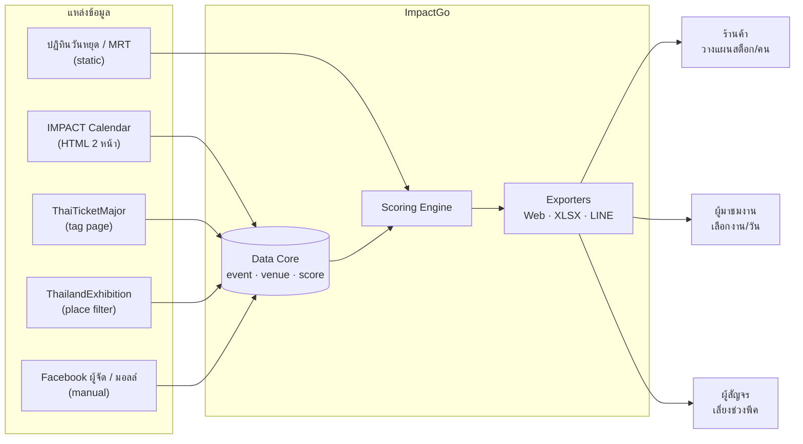
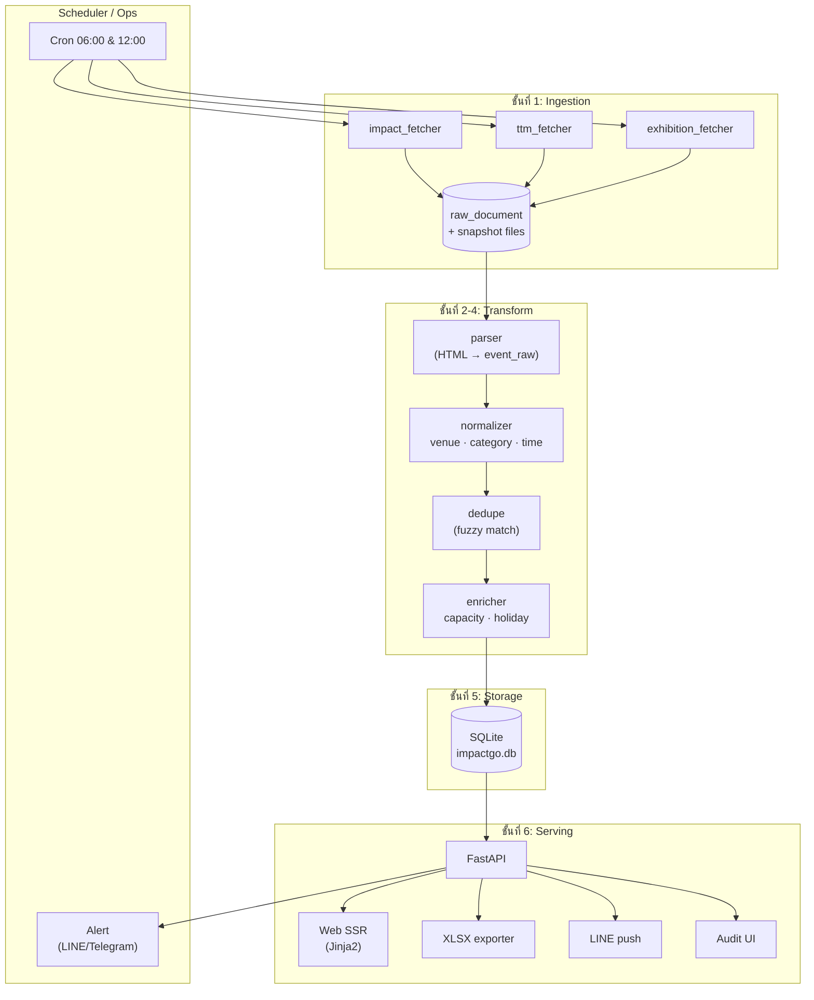
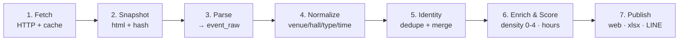
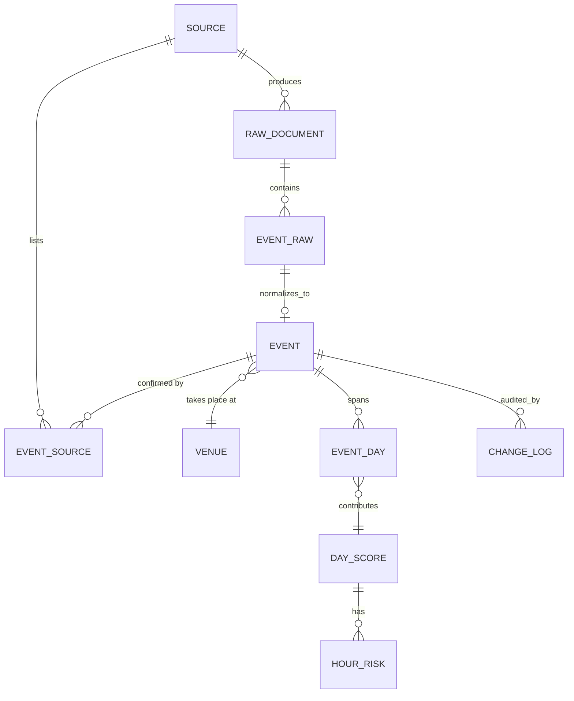

# สถาปัตยกรรมระบบ ImpactGo

> ฉบับ 1.0 · 24 ต.ค. 2026 · ออกแบบสำหรับ MVP 4 สัปดาห์ และขยายได้ถึง ~1,000 งาน/ปี

---

## 1. หลักการออกแบบ

| หลัก | ความหมายในทางปฏิบัติ |
|---|---|
| **Source-agnostic** | เพิ่มแหล่งข้อมูลใหม่ได้โดยไม่แก้ core — เขียน adapter ใหม่ 1 ไฟล์ |
| **Snapshot-first** | เก็บ HTML/JSON ดิบทุกครั้งที่ดึง เพื่อ debug และ re-parse ได้โดยไม่ต้องยิงซ้ำ |
| **Human-in-the-loop** | ระบบไม่แต่งข้อมูลเอง ถ้าไม่มั่นใจให้ mark `unverified` และเข้าคิวให้คนตรวจ |
| **Explainable score** | ทุกคะแนนต้องตอบได้ว่า "มาจากงานไหน อาคารไหน น้ำหนักเท่าไร" |
| **Idempotent** | รันซ้ำกี่ครั้งก็ได้ผลเท่าเดิม (upsert ตาม natural key) |
| **Graceful degradation** | แหล่งใดล่ม ยังเสิร์ฟข้อมูลล่าสุดพร้อมป้ายเตือน ไม่ใช่หน้าว่าง |

---

## 2. Context Diagram



---

## 3. Container Diagram



---

## 4. Data Pipeline (7 ขั้น)



| ขั้น | อินพุต | เอาต์พุต | ความถี่ | ตรวจสอบ |
|---|---|---|---|---|
| 1 Fetch | URL | HTML | 2×/วัน | HTTP 200, ขนาด >20KB |
| 2 Snapshot | HTML | ไฟล์ + SHA256 | ทุกครั้ง | hash เปลี่ยน/ไม่เปลี่ยน |
| 3 Parse | HTML | `event_raw` | ตาม fetch | จำนวนการ์ด ±30% |
| 4 Normalize | raw fields | canonical fields | ตาม parse | venue map ครบ 100% |
| 5 Identity | canonical | `event` + `event_source` | ตาม parse | duplicate rate <5% |
| 6 Score | event + venue | `day_score`, `hour_risk` | หลัง merge | คะแนนมี explanation |
| 7 Publish | score + event | หน้าเว็บ/ไฟล์/ข้อความ | 06:30, 12:30 | ส่งสำเร็จ/ยอดเปิด |

---

## 5. โมเดลข้อมูล



### ตารางหลัก

| ตาราง | บทบาท | คีย์สำคัญ |
|---|---|---|
| `source` | ทะเบียนแหล่งข้อมูล + ความน่าเชื่อถือ | `code` (impact/ttm/exhibition/manual) |
| `raw_document` | ไฟล์ดิบที่ดึงมา | `(source_id, url, fetched_at)` |
| `event_raw` | ข้อมูลก่อนแปลง | `id`, `raw_document_id` |
| `venue` | อาคาร/ฮอลล์ + ความจุ | `code`, `building`, `hall` |
| `event` | งานที่รวมแล้ว (canonical) | `id`, `identity_hash` |
| `event_source` | หลักฐานว่างานนี้มาจากไหน | `(event_id, source_id, source_ref)` |
| `event_day` | วันที่งานดำเนินอยู่ (1 แถว/วัน) | `(event_id, date)` |
| `day_score` | คะแนนความหนาแน่นรายวัน | `date` |
| `hour_risk` | ช่วงชั่วโมงเสี่ยง | `(date, window)` |
| `change_log` | ประวัติเพิ่ม/แก้/ยกเลิก | `(entity, entity_id, changed_at)` |
| `digest` | ข้อความที่ส่งออก | `(channel, period, sent_at)` |

> DDL จริงอยู่ที่ [`db/schema.sql`](db/schema.sql)

---

## 6. กฎ Normalization

### 6.1 อาคารและฮอลล์

| ข้อความต้นทาง (ตัวอย่าง) | แปลงเป็น | ฮอลล์ |
|---|---|---|
| อิมแพ็ค อารีน่า / IMPACT Arena | `ARENA` | — |
| อิมแพ็ค ชาเลนเจอร์ / IMPACT Challenger | `CHALLENGER` | ดึงจาก `Hall n` ถ้ามี |
| ศูนย์แสดงสินค้า อิมแพ็ค เมืองทองธานี / IMPACT Exhibition Center | `EXHIBITION` | **ส่วนใหญ่ไม่ระบุ** → `hall=null` |
| อิมแพ็ค ฟอรั่ม / IMPACT Forum | `FORUM` | — |
| ธันเดอร์โดม / Thunder Dome | `THUNDER` | — |
| ริมทะเลสาบ / IMPACT Lakeside | `LAKESIDE` | — |
| อิมแพ็ค สปีด พาร์ค | `SPEEDPARK` | — |
| เดอะ พอร์ทอล (บอลรูม) | `PORTAL` | — |
| ไม่รู้จัก | `OTHER` + flag | — |

**กฎ:** ถ้า `hall=null` ให้คง `hall_confidence=low` และแสดงใน UI ว่า "อาคารนี้มีหลายฮอลล์" — ห้ามเดาฮอลล์เอง

### 6.2 ประเภทงาน (category)

| หมวดระบบ | ที่มา |
|---|---|
| `concert` | ตัวกรอง "คอนเสิร์ต" หรือชื่อมี CONCERT / WORLD TOUR / FANCON |
| `public_fair` | "งานแสดงสินค้า สาธารณะ", ชื่อมี EXPO/FAIR/มหกรรม (และไม่ใช่ trade) |
| `trade` | "งานแสดงสินค้า ธุรกิจการค้า" หรือมีคำว่า Trade / Congress ร่วม |
| `congress` | "งานประชุม", "การประชุม / สัมมนา", ชื่อมี Congress / Conference |
| `exam` | "งานสอบ" |
| `sport` | "กีฬา", ชื่อมี MARATHON / RACE / LEAGUE |
| `family` | "การแสดงสำหรับครอบครัว" |
| `special` | "Special Event" / อื่น ๆ |

### 6.3 กลุ่มผู้ชม (audience)

- `trade_only` — หมวด trade และไม่มีสัญญาณว่าเปิดให้บุคคลทั่วไป
- `public` — public_fair, concert, family, sport, special
- `mixed` — congress/exam ที่มีทั้งผู้เข้าร่วมและผู้ติดตาม
- `unknown` — ค่าเริ่มต้น ห้ามใช้ตัดสินใจ

### 6.4 เวลา

- ถ้าต้นทางมีเวลา → ใช้ค่านั้น
- ถ้าไม่มี → ใช้ค่า default ตามประเภท (ดู §7.3) และตั้ง `time_confidence=default`
- งานข้ามคืน (คอนเสิร์ตจบหลังเที่ยงคืน) → `end_time` ของวันถัดไป

### 6.5 ราคา

- พบคำว่า "ฟรี" → `is_free=1`
- พบตัวเลข + "บาท" → `is_free=0`, `price_min/max`
- ไม่พบ → `is_free=null` (แสดง "ไม่ระบุ")

### 6.6 Identity / Dedupe

```
identity_hash = sha1(
    normalize_title(title) + "|" +
    primary_venue_code + "|" +
    start_date
)
```

- `normalize_title`: lowercase, ลบปี/ครั้งที่, ลบเครื่องหมาย, ยุบช่องว่าง
- ถ้า hash ไม่ตรงแต่ชื่อคล้ายกัน ≥0.80 (token set ratio) + อาคารเดียวกัน + วันห่าง ≤1 → ถือว่าเป็นงานเดียวกันและรวมเป็น `event_source`
- งานที่มีชื่อซ้ำแต่ต่างอาคาร (เช่น งานแถลงข่าว) → แยก

---

## 7. Scoring Engine

### 7.1 หลักคิด

ความหนาแน่น ≠ จำนวนงาน แต่ = **ขนาดอาคาร × ชนิดงาน × จำนวนอาคารที่ใช้พร้อมกัน × วันในสัปดาห์**
นับ "อาคาร" เป็นหน่วย ไม่นับงานซ้ำในอาคารเดียวกัน (กันการนับซ้ำเช่น 3 งานพิมพ์ในฮอลล์เดียวกัน)

### 7.2 สูตร

```
building_score(b) = max(type_weight ของงานในอาคาร b) × building_weight(b)
raw = Σ building_score(b)
raw = raw × overlap_factor × day_factor
overlap_factor = 1 + 0.10 × (จำนวนอาคารที่ใช้งาน − 1)   // cap 1.30
day_factor = 1.15 ถ้าเป็น ศ/ส/อา/วันหยุดราชการ, else 1.00
```

| building_weight | ค่า |
|---|---|
| ARENA | 3.0 |
| CHALLENGER | 2.5 |
| EXHIBITION | 2.0 |
| THUNDER | 1.5 |
| FORUM | 1.2 |
| LAKESIDE / SPEEDPARK / PORTAL / OTHER | 0.8 |

| type_weight | ค่า |
|---|---|
| concert | 1.3 |
| public_fair / family | 1.2 |
| exam / sport | 1.0 |
| special | 0.9 |
| trade | 0.8 |
| congress | 0.6 |
| unknown | 0.7 |

### 7.3 ระดับคะแนน

| ระดับ | ช่วง raw | ความหมาย | การใช้งาน |
|---|---|---|---|
| 0 | < 0.1 | ไม่มีงาน | วันปฏิบัติการภายใน |
| 1 | 0.1 – 2.4 | เบา | เปิดร้านปกติ |
| 2 | 2.5 – 4.4 | ปานกลาง | เพิ่มสต็อกเล็กน้อย |
| 3 | 4.5 – 6.4 | หนัก | เพิ่มคน/ของ 1.5× |
| 4 | ≥ 6.5 | หนักมาก | เตรียมเต็มที่ + เลี่ยงช่วงเวลา |

> **ต้อง calibrate หลังวัดจริง 2 สัปดาห์** — ตัวเลขเหล่านี้เป็นสมมติฐาน ไม่ใช่ความจริง

### 7.4 ตัวอย่างที่คำนวณแล้ว (7 พ.ย. 2026)

| อาคาร | งาน | type_weight | building_weight | คะแนน |
|---|---|---|---|---|
| ARENA | BABYMONSTER World Tour | 1.3 | 3.0 | 3.90 |
| EXHIBITION | Thailand Mobile Expo + AI Expo (+3 งานพิมพ์) | 1.2 | 2.0 | 2.40 |
| FORUM | FAPA Congress | 0.6 | 1.2 | 0.72 |
| **รวม** | | | | **7.02** |

`7.02 × 1.20 (3 อาคาร) × 1.15 (เสาร์) = 9.69` → **ระดับ 4**

### 7.5 ช่วงชั่วโมงเสี่ยง

| ประเภท | ขาเข้า | ขาออก |
|---|---|---|
| concert (Arena/Thunder) | 17:00–19:30 | 21:30–23:30 |
| public_fair / family | 09:30–11:00 | 19:30–21:00 |
| trade | 08:30–10:00 | 17:00–18:30 |
| congress | 08:00–09:00 | 16:30–18:00 |
| exam | 07:00–08:30 | 15:30–17:00 |
| sport | เริ่ม−2 ชม. | จบ+30 นาที |

ถ้ามีหลายงาน ใช้ **union ของช่วงเวลา** และติดป้าย `reason` ว่าเกิดจากงานใด

---

## 8. Output Surfaces

### 8.1 เว็บ (SSR, มือถือก่อน)

| หน้า | เนื้อหา |
|---|---|
| `/` | การ์ด "วันนี้/พรุ่งนี้" + 8 สัปดาห์ถัดไป + ป้ายระดับ |
| `/calendar` | ปฏิทินรายเดือน + ตัวกรอง (ฟรี/เสียเงิน, ประเภท, อาคาร) |
| `/day/{date}` | งานทั้งหมดในวันนั้น + ช่วงเวลาเสี่ยง + ที่จอดที่แนะนำ |
| `/event/{id}` | รายละเอียด + แหล่งที่มา + `last_verified_at` + ปุ่ม .ics |
| `/about` | แหล่งข้อมูล ข้อจำกัด และข้อความ "ไม่ใช่ข้อมูลทางการ" |

### 8.2 Excel (6 สัปดาห์)

คอลัมน์: `วันที่ | วัน | จำนวนงาน | อาคาร | งานเด่น | ระดับ 0-4 | ช่วงเข้า | ช่วงออก | หมายเหตุ`

- แถบสีตามระดับ, freeze header, ความกว้างคงที่
- ชีตที่ 2: รายการงานทั้งหมด (เผื่อร้านค้าอยากกรองเอง)
- ชีตที่ 3: คำอธิบายวิธีอ่าน + ข้อจำกัด

### 8.3 LINE (3 แบบ)

**แบบ A — ร้านค้า (ทุกจันทร์ 08:00)**
```
📅 สัปดาห์ 3–9 พ.ย. เมืองทองธานี
พีค: พฤ 5 – อา 8 พ.ย. (ระดับ 4)
• พฤ 5–8: Mobile Expo + 3 งานพิมพ์ + FAPA (3 อาคาร)
• ส 7: หนักสุด — คอนเสิร์ต Arena + 4 งานในศูนย์แสดงสินค้า
แนะนำ: เพิ่มสต็อก 1.5–2×, จ้างพาร์ทไทม์ 5–8, เลี่ยงรับของ 17:00–19:00
วันเบา: จ. 9 – อ. 10 (เติมของ/นับสต็อก)
```

**แบบ B — ผู้มาชมงาน (ทุกพฤหัส)**
```
🎪 งานเร็ว ๆ นี้
• 5–8 พ.ย. Thailand Mobile Expo & AI Expo — ฟรี
• 7–8 พ.ย. BABYMONSTER World Tour — มีบัตร
• 13–15 พ.ย. TGU 2026 — ฟรี
ดูทั้งหมด: <ลิงก์>
```

**แบบ C — คนผ่าน (วันงาน 16:00)**
```
🚗 วันนี้มี 3 งาน (ระดับ 3)
หลบ 17:00–19:30 (ขาเข้า) และ 21:30–23:00 (ขาออก)
ทางเลี่ยง: <ลิงก์แผนที่>
```

---

## 9. API (อ่านอย่างเดียวเป็นหลัก)

| Method | Path | คำตอบ |
|---|---|---|
| GET | `/api/v1/days?from=&to=` | รายวัน + score + จำนวนงาน |
| GET | `/api/v1/days/{date}` | รายละเอียดวัน + hour risk + events |
| GET | `/api/v1/events?from=&to=&venue=&category=&audience=&free=` | รายการงาน |
| GET | `/api/v1/events/{id}` | งาน + sources + confidence |
| GET | `/api/v1/export.xlsx?weeks=6` | ไฟล์ Excel |
| GET | `/api/v1/digest?week=2026-W45&audience=merchant` | ข้อความ LINE (dry-run) |
| GET | `/healthz` | สถานะ + freshness + last scrape |
| POST | `/admin/events/{id}/verify` | ยืนยันข้อมูล (ต้อง auth) |
| POST | `/admin/events/{id}/override` | แก้ค่า + บันทึกเหตุผล |
| GET | `/admin/queue` | คิวงานที่ต้องตรวจ |

**Response ตัวอย่าง**
```json
{
  "date": "2026-11-07",
  "score": 4,
  "event_count": 7,
  "buildings": ["ARENA", "EXHIBITION", "FORUM"],
  "headline": "BABYMONSTER World Tour + Mobile Expo + FAPA",
  "hours": [
    {"from": "17:00", "to": "19:30", "direction": "in", "level": 4},
    {"from": "21:30", "to": "23:30", "direction": "out", "level": 4}
  ],
  "confidence": "medium",
  "last_verified_at": "2026-11-06T18:20:00+07:00"
}
```

---

## 10. Tech Stack

| ชั้น | เลือก | เหตุผล | ทางเลือก |
|---|---|---|---|
| ภาษา | Python 3.11+ | ไลบรารี scraping/data ครบ คนเดียวดูแลได้ | Node/TS |
| HTTP | `httpx` | timeout/retry ง่าย | requests |
| Parse | `selectolax` + regex | เร็ว, HTML เรียบง่าย | BeautifulSoup |
| Fallback | Playwright | หน้าที่เรนเดอร์ด้วย JS (thailandexhibition) | Selenium |
| DB | **SQLite (WAL)** | ข้อมูล <10k แถว, ไฟล์เดียว, backup ง่าย | Postgres (เมื่อมีผู้ใช้ >1k/วัน) |
| ORM | SQLAlchemy 2 + Alembic | migration ตรวจย้อนได้ | sqlite3 ล้วน |
| API/Web | FastAPI + Jinja2 | SSR เบา, เร็ว, เอกสาร API อัตโนมัติ | Flask |
| Excel | openpyxl | จัดสี/format ได้ | xlsxwriter |
| LINE | Messaging API (push/broadcast) | ตรงกลุ่มเป้าหมายไทย | Telegram (ทดสอบ) |
| Scheduler | GitHub Actions cron หรือ systemd timer | ฟรี/เสถียร | cron ใน VPS |
| Host | VPS 1 vCPU/1GB + Caddy | <500 บาท/เดือน, TLS อัตโนมัติ | Cloud Run |

**ทางเลือกแบบไม่เขียนโค้ด (ถ้าเวลาจำกัดมาก):** Google Sheets + Apps Script + `IMPORTHTML`
→ ข้อดี: เริ่มได้ใน 1 วัน · ข้อเสีย: เปราะเมื่อ HTML เปลี่ยน, จัดการ dedupe/scoring ยาก, ไม่มี audit
→ ใช้เป็น "ตัวพิสูจน์ความต้องการ" 2 สัปดาห์ได้ แต่ไม่ควรใช้เป็นระบบระยะยาว

---

## 11. Deployment

```
┌──────────────── VPS (1 vCPU / 1GB) ────────────────┐
│  Caddy (443) ── FastAPI (uvicorn, 2 workers)        │
│       │                                             │
│       ├── SQLite  /srv/impactgo/data/impactgo.db    │
│       ├── snapshots /srv/impactgo/data/snapshots/   │
│       └── exports  /srv/impactgo/data/exports/      │
│  systemd timer: ingest 06:00, 12:00                 │
│                 score  06:30, 12:30                 │
│                 digest จันทร์ 08:00                 │
└─────────────────────────────────────────────────────┘
```

- **Environments:** `dev` (local, SQLite ไฟล์แยก) / `prod` (VPS)
- **Config:** `.env` (token LINE, admin password hash, base URL) — ห้าม commit
- **Backup:** `sqlite3 .backup` รายวัน + เก็บ snapshot 90 วัน + copy ขึ้น object storage ฟรี
- **Rollback:** เก็บ release ก่อนหน้า 2 เวอร์ชัน + DB backup ก่อน migrate

---

## 12. Observability & Data Quality

### 12.1 Metrics ที่ต้องมี
| Metric | เกณฑ์เตือน |
|---|---|
| `scrape_success_rate` | <95% |
| `events_parsed_total` | เปลี่ยน ±30% จากค่าเฉลี่ย 7 วัน |
| `parse_error_count` | >0 ติด 2 รอบ |
| `duplicate_rate` | >5% |
| `unverified_ratio` | >40% |
| `freshness_hours` | >24 ชม. |
| `line_push_failures` | >2 ครั้ง/สัปดาห์ |

### 12.2 Data quality checks (รันทุกครั้งหลัง ingest)
1. ทุก `event` ต้องมี `venue_code` และ `start_date`
2. ไม่มี `end_date < start_date`
3. จำนวนงานใน 60 วันข้างหน้า ต้อง ≥80% ของค่าก่อนหน้า (กัน parse พังเงียบ)
4. งานทุกงานต้องมี `event_source` อย่างน้อย 1 รายการ
5. `day_score` ต้องมี explanation ครบ (รายชื่ออาคาร)
6. วันที่ในอดีตต้องถูก mark `past` ไม่ปนกับ upcoming

### 12.3 Alert
- เข้า LINE/Telegram ของผู้ดูแล พร้อมลิงก์หน้า audit
- ข้อความสั้น: " ingest ล้มเหลว 2 รอบ: impact_fetcher (HTTP 503) — ใช้ข้อมูลล่าสุด 24 ชม."

---

## 13. ความปลอดภัย กฎหมาย และ PDPA

| ประเด็น | แนวปฏิบัติ |
|---|---|
| robots.txt / ToS | ตรวจก่อนเพิ่มแหล่ง; ถ้าห้าม crawl → ใช้ manual/ขออนุญาต |
| Rate limit | ≤1 request/2 วินาที/โดเมน, cache 24 ชม., ระบุ User-Agent ชัดเจน |
| ลิขสิทธิ์รูป | **ไม่ republish รูปต้นทาง**; ใช้ข้อความ+ลิงก์ หรือรูปที่ได้รับอนุญาต |
| เครดิต | ทุกหน้ามี "ข้อมูลจาก: ..." + เวลาที่ดึง |
| ข้อมูลส่วนบุคคล | MVP ไม่มีบัญชีผู้ใช้; ถ้าเก็บ LINE userId ต้องมี consent + นโยบายความเป็นส่วนตัว + ลบได้ |
| ความรับผิด | ระบุชัด "ไม่ใช่ข้อมูลทางการของอิมแพ็ค/ผู้จัด" และ "ประมาณการ" |
| ชื่อ/โลโก้ | ห้ามใช้โลโก้ IMPACT ในลักษณะทำให้เข้าใจว่าเป็นทางการ |

---

## 14. Failure Modes และการรับมือ

| อาการ | สาเหตุ | การรับมือ |
|---|---|---|
| หน้าเว็บว่าง | DB ว่าง/permission | fallback หน้าสถิติ + banner "กำลังปรับปรุง" |
| งานหายทั้งชุด | selector เปลี่ยน | ใช้ snapshot ล่าสุด re-parse + alert + manual CSV |
| งานซ้ำ 2 รายการ | ชื่อต่างเล็กน้อย | ปรับ threshold fuzzy + merge tool ในหน้า admin |
| คะแนนเฟ้อ | นับซ้ำหลายงานในอาคารเดียว | ใช้ `max(type_weight)` ต่ออาคาร (บังคับในโค้ด) |
| LINE ส่งไม่ครบ | โควตาข้อความ | รวมข้อความ/ลดความถี่ + ตรวจแพ็กเกจ |
| งานยกเลิกแต่ยังแสดง | ต้นทางไม่อัปเดต | ป้าย `last_verified_at` + ช่องทางยืนยัน + mark cancelled ด้วยมือ |

---

## 15. ขนาดและข้อจำกัด

- ปริมาณ: ~100–300 งาน/ไตรมาส, ~1,000 แถว `event_day`/ปี → SQLite เกินพอ
- ผู้ใช้คาดหวัง: <5,000 คน/เดือน → 1 vCPU รับได้ (หน้า SSR + cache 5 นาที)
- จุดที่ต้องเปลี่ยนสถาปัตยกรรม: ถ้าต้องการ real-time occupancy, หลายภาษาเต็มรูปแบบ, หรือ API ให้พันธมิตรจำนวนมาก → ย้าย Postgres + cache layer

---

## 16. Build vs Buy

| ทางเลือก | ทำได้ | ไม่ทำได้ | สรุป |
|---|---|---|---|
| Google Calendar ส่วนตัว | ใสงานมือ | ไม่มีคะแนน/คัดกรอง/อัตโนมัติ | ไม่พอ |
| Sheets + Apps Script | ตาราง + IMPORTHTML | dedupe/scoring/audit อ่อน | ใช้พิสูจน์ได้ชั่วคราว |
| ซื้อ data จากผู้จัด | ถูกต้องกว่า | แพง/ไม่ครอบคลุม/ไม่มีทราฟฟิก | ไม่จำเป็นใน MVP |
| **สร้างเอง (แผนนี้)** | ครบตามต้องการ | ต้องดูแลต่อเนื่อง | **เลือกทางนี้** |

---

## 17. โครงสร้างโค้ดที่แนะนำ

```
impactgo/
├── app/
│   ├── fetchers/        impact.py  ttm.py  exhibition.py
│   ├── parsers/         impact_html.py
│   ├── normalize/       venue.py  category.py  timeparse.py
│   ├── scoring/         score.py  hours.py
│   ├── db/              models.py  migrate.py  seed_venues.py
│   ├── web/             main.py  templates/  static/
│   ├── exporters/       xlsx.py  line.py  ics.py
│   └── admin/           routes.py  templates/
├── tests/               fixtures/impact_2026-10-24.html
├── data/                snapshots/  exports/
├── ops/                 runbook.md  cron.md
└── db/schema.sql
```

**Test strategy:** fixture HTML จริง 1 ไฟล์/แหล่ง + test การ parse/วันที่/venue map + smoke test หน้าเว็บ (ทุกครั้งที่แก้ selector)
